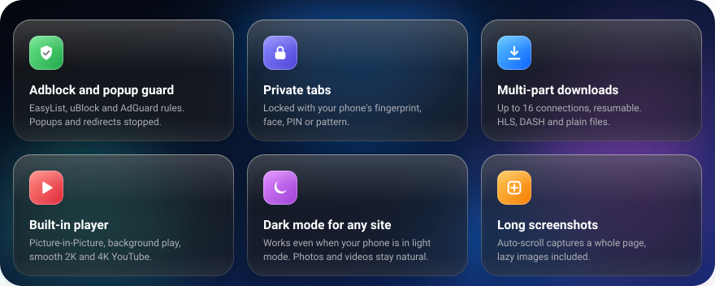
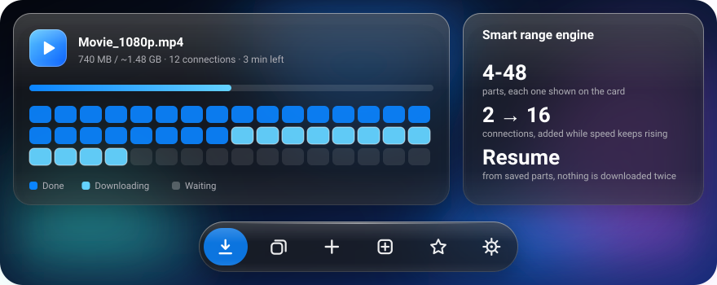

<div align="center">

<p>
<a href="https://github.com/aman-nitb-cse/Aurex-Browser/releases/latest"></a>

<a href="https://github.com/aman-nitb-cse/Aurex-Browser/stargazers"></a>
<a href="https://github.com/aman-nitb-cse/Aurex-Browser/releases"></a>

</p>
<p>
<a href="https://github.com/aman-nitb-cse/Aurex-Browser/releases/latest"></a>
<a href="https://t.me/aurex_oss"></a>
</p>
<b>A fast, private Android browser with a Liquid Glass interface.</b><br>
Ad blocker · Popup guard · Built-in player · Multi-part video downloader<br>
No account. No server.
 
</div>
<br>
## 🪟 Liquid Glass, top to bottom
 
<div align="center">

</div>
Aurex's floating toolbar, cards and panels are built as layered glass: a translucent fill, a soft highlight on the top edge, a two-tone rim and a gentle glow at the bottom.
 
- **Floating glass toolbar** you can fully rearrange
- **Transparency slider**, from clear glass to tinted glass
- **Light, Dark and Auto** themes, with a dark mode that also works on websites
## ⚡ Multi-part downloads
 
<div align="center">

</div>
Big files are split into **4-48 parts** and fetched over **2-16 parallel connections**. The engine adds connections while each one still makes the download at least 10% faster, backs off when a server throttles it, and **resumes from the parts already saved**.
 
- HLS (with AES-128), DASH and plain files, plus a universal downloader powered by yt-dlp and FFmpeg
- Quality picker for video and audio, or *Always best quality*
- Pause, resume, retry, multi-select, swipe to delete or share
- Downloaded videos stay seekable, with no re-encoding
## ✨ Also inside
 
| | |
|---|---|
| 🛡️ **Blocking** | EasyList, uBlock Origin and AdGuard rules, cosmetic filtering, YouTube ad skipping, smart popup and redirect guard |
| 🔒 **Privacy** | Private tabs locked with your phone's own lock, adult-content filter, third-party cookie blocking |
| 🎬 **Media** | Picture-in-Picture, background playback, floating media button, media dock |
| 🌐 **Browsing** | Reader mode, find in page, bookmarks, history, desktop site, data saver, long screenshots, seven search engines |
| 🔄 **Updates** | Updates itself from GitHub Releases with a SHA-256 check |
 
## 📲 Install
 
1. Download the `.apk` from the [latest release](https://github.com/aman-nitb-cse/Aurex-Browser/releases/latest)
2. Open it and allow installation if asked
3. Tap **Install**
Needs Android 7.0 or newer.
 
## 🛠️ Build
 
Needs **JDK 17** and **Android SDK 35** (or just Android Studio).
 
```bash
git clone https://github.com/aman-nitb-cse/Aurex-Browser.git
cd Aurex-Browser
./gradlew assembleDebug
```
 
<details>
<summary>Permissions</summary>
| Permission | Why |
|---|---|
| Internet, network state | Browsing, filter updates, downloads |
| Notifications, foreground service, wake lock | Download progress and background playback |
| Biometric | Phone-lock check for private tabs and the adult filter |
| Install packages | In-app updates |
| Camera, microphone, location | Only when a website asks for them |
 
</details>
## 🤝 Contributing
 
Fork, make your change, check that `./gradlew assembleDebug` builds, then open a pull request. Found a bug? [Open an issue](https://github.com/aman-nitb-cse/Aurex-Browser/issues) and paste the log from **Settings → General → Copy log**.
 
The downloader relies on yt-dlp. Please respect copyright law and the terms of the sites you use.
 
## 📄 License
 
GNU GPL v3.0. See [LICENSE](LICENSE). Built on [yt-dlp](https://github.com/yt-dlp/yt-dlp), [youtubedl-android](https://github.com/JunkFood02/youtubedl-android), [FFmpeg](https://ffmpeg.org), [AndroidX Media3](https://github.com/androidx/media), [OkHttp](https://github.com/square/okhttp) and community filter lists. Full credits are in **Settings → About**.
 
<div align="center">
<br>
Made with ❤️ by **AMAN** · ⭐ Star the repo if you like Aurex
 
</div>
 
