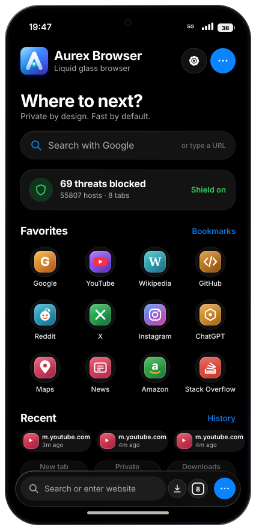
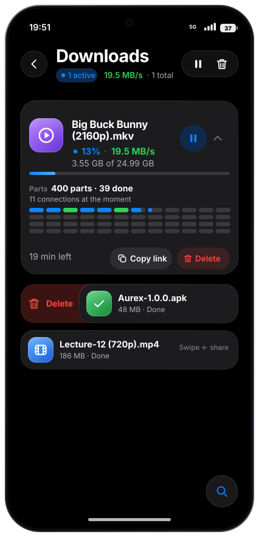
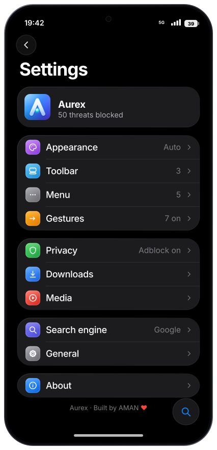
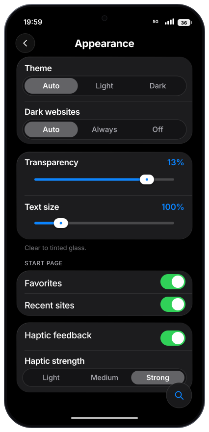

<a id="top"></a>

<div align="center">



<p>
<a href="https://github.com/aman-nitb-cse/Aurex-Browser/releases/latest"></a>

<a href="https://github.com/aman-nitb-cse/Aurex-Browser/stargazers"></a>
<a href="https://github.com/aman-nitb-cse/Aurex-Browser/releases"></a>

</p>

<p>
<a href="https://github.com/aman-nitb-cse/Aurex-Browser/releases/latest"></a>
<a href="https://t.me/aurex_oss"></a>
</p>

<h3>A fast, private Android browser with a Liquid Glass interface.</h3>
<p>Ad blocker · Popup guard · Built-in player · Multi-part video downloader<br>No account. No server.</p>

<p>
<a href="#screens"><b>Screens</b></a> &nbsp;·&nbsp;
<a href="#glass"><b>Liquid Glass</b></a> &nbsp;·&nbsp;
<a href="#shield"><b>Shield</b></a> &nbsp;·&nbsp;
<a href="#downloads"><b>Downloads</b></a> &nbsp;·&nbsp;
<a href="#player"><b>Player</b></a> &nbsp;·&nbsp;
<a href="#privacy"><b>Privacy</b></a> &nbsp;·&nbsp;
<a href="#install"><b>Install</b></a>
</p>




</div>

<br>

<a id="screens"></a>

## 📱 See it

<div align="center">
<table>
<tr>
<td align="center" valign="top"><br><b>Home</b><br><sub>Search pill, Shield counter,<br>favourites and recent sites</sub></td>
<td align="center" valign="top"><br><b>Downloads</b><br><sub>Live parts map, speed,<br>time left and swipe actions</sub></td>
<td align="center" valign="top"><br><b>Settings</b><br><sub>Searchable and grouped,<br>ten sections</sub></td>
<td align="center" valign="top"><br><b>Appearance</b><br><sub>Theme, dark websites,<br>transparency, haptics</sub></td>
</tr>
</table>

<br>
<b>Built-in player</b><br>
<sub>Aspect, screen lock, speed and quality, one tap away</sub>
</div>

<br>

## ✨ What's inside

<div align="center">

</div>

<br>

| | | |
|:--|:--|:--|
| 🛡️ **Shield**<br><sub>Ads, trackers and popups blocked on your phone, with rules from EasyList, uBlock Origin and AdGuard.</sub> | 🔒 **Private by design**<br><sub>Private tabs open only behind your phone's own lock. No account, no server.</sub> | 🌙 **Dark websites**<br><sub>Any site in dark mode, even in a light theme. Photos and video keep their natural colours.</sub> |
| 🎬 **Built-in player**<br><sub>Gestures, Picture-in-Picture and background playback.</sub> | ⬇️ **Universal downloader**<br><sub>yt-dlp and FFmpeg built in. Files are split into parts and fetched over many connections.</sub> | 🎛️ **Yours to arrange**<br><sub>Pick toolbar and menu items, set gestures, choose from seven search engines.</sub> |


<a id="glass"></a>

## 🪟 Liquid Glass, top to bottom

<div align="center">

</div>

<br>

Aurex's floating toolbar, cards and panels are built as layered glass: a translucent fill, a soft highlight on the top edge, a two-tone rim and a gentle glow at the bottom. One radius system, one accent and one set of haptics are shared by every screen, so nothing feels bolted on.

- **Concentric radii**: 26 → 16 → 12 for cards, tiles and controls, so nested shapes always line up
- **Transparency slider**: from clear glass to tinted glass, you decide how much of the page shows through
- **Light, Dark and Auto** themes, plus a **Dark websites** engine (Auto · Always · Off) that also darkens sites that have no dark mode
- **Floating glass toolbar** that you can fully rearrange
- **Haptics you can feel**: 12 events (press, tap, tick, toggle, drag, threshold, success, error, warn and more) all routed through one place, with Light, Medium and Strong strength, or off
- **Apple-style system colours**: accent `#0A84FF`, good `#30D158`, warn `#FF9F0A`, bad `#FF453A`


<a id="shield"></a>

## 🛡️ Shield: ads, trackers and popups

<div align="center">

</div>

<br>

Every request walks through four stages. Filter lists decide first (an exception rule beats the older heuristics), then host lists. Popups are judged by behaviour, and whatever ads leave behind is hidden. Captcha, login and payment hosts are never blocked, so pages keep working.

| Stage | What it does |
|:--|:--|
| **Filter rules** | Real Adblock-Plus rules from EasyList, EasyPrivacy, uBlock Origin and AdGuard, token-indexed so matching stays fast |
| **Host lists** | Bundled lists (StevenBlack, Peter Lowe) with a weekly refresh |
| **Popup guard** | Judges the behaviour of every jump and `window.open()` instead of guessing from a list |
| **Cosmetic hiding** | Removes the empty boxes and banners that blocked ads leave behind |
| **YouTube** | Ad skipping on top of the filters |
| **Cookies** | Third-party cookie blocking |

**The popup guard asks four questions before a jump is allowed**

| | Question | Why it matters |
|:-:|:--|:--|
| 👆 | **Did you tap it?** | A real tap on that very link is remembered for a few seconds |
| 🌐 | **Is it another site?** | Same site, a big trusted site, or a site you trust is fine |
| ↩️ | **A round-trip?** | Login and payment pages this tab already visited are allowed |
| ⚡ | **Does it look like an ad?** | Click-id parameters, abused endings, raw IPs and random names give it away |


<a id="downloads"></a>

## ⚡ Multi-part downloads

<div align="center">

</div>

<br>

Big files are split into **4-48 parts** and fetched over **2-16 parallel connections**. The engine adds connections while each one still makes the download at least 10% faster, backs off when a server throttles it, and **resumes from the parts already saved**.

- **HLS** (with AES-128), **DASH** and plain files, plus a **universal downloader** powered by yt-dlp and FFmpeg
- **Live parts map** on every download: speed, connections in use and time left, at a glance
- **Pause, resume, retry**, multi-select, swipe to delete or share, copy link
- **Downloaded videos stay seekable**, with no re-encoding
- **Floating download button** over a playing video for a quick save

### Pick a quality, one-handed

<div align="center">

</div>

<br>

The quality picker is a compact card, not a full-screen sheet: it sits in the bottom-right corner where your right thumb rests and the page stays visible behind it. Each row shows its size up front, audio-only MP3 and M4A sit side by side on a single row, and **Always best quality** skips the card entirely and saves the highest quality every time.


<a id="player"></a>

## 🎬 Built-in player and media tools

<div align="center">

</div>

<br>

- **Gestures**: swipe to seek or change brightness and volume, double-tap, long-press and pinch
- **Speed** from 0.25x to 3x, plus aspect ratio, screen lock and a quality switch
- **Picture-in-Picture** and **background playback**
- **2K / 4K** offered only if your phone can decode it
- **Floating media button** and **media dock** to reach your player from any page


<a id="privacy"></a>

## 🔒 Private by design

<div align="center">
<table>
<tr>
<td width="33%" valign="top"><b>Private tabs behind your lock</b><br><sub>They open only after your phone's own lock: fingerprint, face, PIN or pattern.</sub></td>
<td width="33%" valign="top"><b>Adult-content filter</b><br><sub>Can only be switched off after the same phone-lock check, so nobody can quietly turn it off.</sub></td>
<td width="33%" valign="top"><b>No account, no server</b><br><sub>Everything runs on your phone. Aurex has no sign-up and no server of its own.</sub></td>
</tr>
</table>
</div>

<br>

## 🎛️ Yours to arrange

Settings are **searchable and grouped** into Appearance, Toolbar, Menu, Gestures, Privacy, Downloads, Media, Search engine, General and About.

- Pick which items live in the **toolbar** and the **menu**, and reorder them
- **7 gestures** you can switch on one by one
- **Seven search engines**
- **Reader mode**, find in page, bookmarks, history, **desktop site**, **data saver**, **long screenshots**

## 🧩 Everything else

| | |
|---|---|
| 🛡️ **Blocking** | EasyList, uBlock Origin and AdGuard rules, cosmetic filtering, YouTube ad skipping, smart popup and redirect guard |
| 🔒 **Privacy** | Private tabs locked with your phone's own lock, adult-content filter, third-party cookie blocking |
| 🎬 **Media** | Picture-in-Picture, background playback, floating media button, media dock |
| 🌐 **Browsing** | Reader mode, find in page, bookmarks, history, desktop site, data saver, long screenshots, seven search engines |
| 🔄 **Updates** | Updates itself from GitHub Releases with a SHA-256 check |


## 🧱 Built with

<div align="center">

</div>

<a id="install"></a>

## 📲 Install

1. Download the `.apk` from the [latest release](https://github.com/aman-nitb-cse/Aurex-Browser/releases/latest)
2. Open it and allow installation if asked
3. Tap **Install**

Needs Android 7.0 or newer. After that, Aurex updates itself from GitHub Releases with a SHA-256 check.

## 🛠️ Build

Needs **JDK 17** and **Android SDK 35** (or just Android Studio).

```bash
git clone https://github.com/aman-nitb-cse/Aurex-Browser.git
cd Aurex-Browser
./gradlew assembleDebug
```

<details>
<summary><b>Permissions</b>: what Aurex asks for and why</summary>

<br>

| Permission | Why |
|---|---|
| Internet, network state | Browsing, filter updates, downloads |
| Notifications, foreground service, wake lock | Download progress and background playback |
| Biometric | Phone-lock check for private tabs and the adult filter |
| Install packages | In-app updates |
| Camera, microphone, location | Only when a website asks for them |

</details>

## 🤝 Contributing

Fork, make your change, check that `./gradlew assembleDebug` builds, then open a pull request. Found a bug? [Open an issue](https://github.com/aman-nitb-cse/Aurex-Browser/issues) and paste the log from **Settings → General → Copy log**.

The downloader relies on yt-dlp. Please respect copyright law and the terms of the sites you use.

## 📄 License

GNU GPL v3.0. See [LICENSE](LICENSE). Built on [yt-dlp](https://github.com/yt-dlp/yt-dlp), [youtubedl-android](https://github.com/JunkFood02/youtubedl-android), [FFmpeg](https://ffmpeg.org), [AndroidX Media3](https://github.com/androidx/media), [OkHttp](https://github.com/square/okhttp) and community filter lists. Full credits are in **Settings → About**.

<br>

<div align="center">


Made with ❤️ by **AMAN** · ⭐ Star the repo if you like Aurex

<a href="#top">↑ Back to top</a>

</div>
