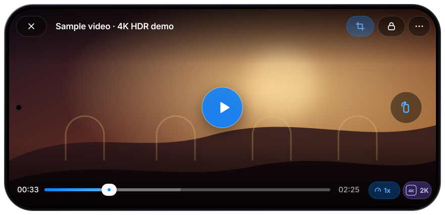

<a id="top"></a>

<div align="center">

<br>
<br>
<p>
<a href="https://github.com/aman-nitb-cse/Aurex-Browser/releases/latest"></a>
<a href="https://t.me/aurex_oss"></a>
</p>
<br>
<p>
<a href="https://github.com/aman-nitb-cse/Aurex-Browser/releases/latest"></a>&nbsp;&nbsp;
&nbsp;&nbsp;
<a href="https://github.com/aman-nitb-cse/Aurex-Browser/stargazers"></a>&nbsp;&nbsp;
<a href="https://github.com/aman-nitb-cse/Aurex-Browser/releases"></a>&nbsp;&nbsp;

</p>
<br>
<p>
<a href="#screens"></a>&nbsp;&nbsp;
<a href="#glass"></a>&nbsp;&nbsp;
<a href="#shield"></a>&nbsp;&nbsp;
<a href="#downloads"></a>&nbsp;&nbsp;
<a href="#player"></a>&nbsp;&nbsp;
<a href="#privacy"></a>&nbsp;&nbsp;
<a href="#install"></a>
</p>
<br>
<br>

</div>

<br>

<a id="screens"></a>

## 📱 See it

<div align="center">
<table>
<tr>
<td align="center" valign="top"><br><b>Home</b><br><sub>Search, Shield counter,<br>favourites, recent sites</sub></td>
<td align="center" valign="top"><br><b>Downloads</b><br><sub>Live parts map, speed,<br>time left, swipe actions</sub></td>
<td align="center" valign="top"><br><b>Settings</b><br><sub>Searchable, ten<br>grouped sections</sub></td>
<td align="center" valign="top"><br><b>Appearance</b><br><sub>Theme, dark websites,<br>transparency, haptics</sub></td>
</tr>
</table>
</div>

<br>

## ✨ What's inside

<div align="center">

</div>

<br>

<a id="glass"></a>

## 🪟 Liquid Glass

<div align="center">

</div>

<br>

The floating toolbar, cards and panels are layered glass: a translucent fill, a soft highlight on the top edge, a two-tone rim and a gentle glow at the bottom. The toolbar is yours to rearrange, and the transparency slider decides how much of the page shows through.

<br>

<a id="shield"></a>

## 🛡️ Shield

<div align="center">

</div>

<br>

- Rules come from **EasyList, EasyPrivacy, uBlock Origin and AdGuard**, host lists from **StevenBlack and Peter Lowe** (refreshed weekly)
- **YouTube ad skipping** on top of the filters
- The **home screen counter** shows how many threats Shield has blocked

<br>

<a id="downloads"></a>

## ⚡ Downloads

<div align="center">

</div>

<br>

Big files are split into **4-48 parts** and fetched over **2-16 parallel connections**, and the engine **resumes from the parts already saved**.

- **HLS** (with AES-128), **DASH** and plain files, plus a **universal downloader** powered by yt-dlp and FFmpeg
- **Pause, resume, retry**, multi-select, swipe to delete or share, copy link
- **Downloaded videos stay seekable**, with no re-encoding
- **Floating download button** over a playing video for a quick save

<br>

<div align="center">

</div>

<br>

The quality picker is a compact card in the bottom-right corner, not a full-screen sheet. Turn on **Always best quality** and it is skipped entirely.

<br>

<a id="player"></a>

## 🎬 Player

<div align="center">

</div>

<br>

| Feature | Details |
|---|---|
| **Gestures** | Swipe to seek or change brightness and volume, double-tap, long-press and pinch |
| **Speed & controls** | Speed from 0.25x to 3x, aspect ratio, screen lock and a quality switch |
| **Picture-in-Picture** | Picture-in-Picture and background playback |
| **2K / 4K** | Offered only if your phone can decode it |
| **Quick access** | Floating media button and media dock to reach the player from any page |

<br>

<a id="privacy"></a>

## 🔒 Privacy

<div align="center">
<table>
<tr>
<td width="33%" valign="top"><b>Private tabs</b><br><sub>Open only behind your phone's own lock: fingerprint, face, PIN or pattern.</sub></td>
<td width="33%" valign="top"><b>Adult-content filter</b><br><sub>Turning it off needs the same phone-lock check.</sub></td>
<td width="33%" valign="top"><b>Third-party cookies</b><br><sub>Blocked, so sites cannot follow you around.</sub></td>
</tr>
</table>
</div>

<br>

## 🌐 Browsing

Reader mode, find in page, bookmarks, history, desktop site, data saver and long screenshots. **7 gestures** you switch on one by one, **seven search engines**, and the toolbar and menu items are yours to pick. Aurex **updates itself** from GitHub Releases with a SHA-256 check.

<br>

## 🧱 Built with

<div align="center">

</div>

<br>

<a id="install"></a>

## 📲 Install

1. Download the `.apk` from the [latest release](https://github.com/aman-nitb-cse/Aurex-Browser/releases/latest)
2. Open it and allow installation if asked
3. Tap **Install**

Needs Android 7.0 or newer.

<br>

## 🛠️ Build

Needs **JDK 17** and **Android SDK 35** (or just Android Studio).

```bash
git clone https://github.com/aman-nitb-cse/Aurex-Browser.git
cd Aurex-Browser
./gradlew assembleDebug
```

<details>
<summary><b>Permissions</b>: what Aurex asks for and why</summary>

| Permission | Why |
|---|---|
| Internet, network state | Browsing, filter updates, downloads |
| Notifications, foreground service, wake lock | Download progress and background playback |
| Biometric | Phone-lock check for private tabs and the adult filter |
| Install packages | In-app updates |
| Camera, microphone, location | Only when a website asks for them |

</details>

<br>

## 🤝 Contributing

Fork, make your change, check that `./gradlew assembleDebug` builds, then open a pull request. Found a bug? [Open an issue](https://github.com/aman-nitb-cse/Aurex-Browser/issues) and paste the log from **Settings → General → Copy log**.

The downloader relies on yt-dlp. Please respect copyright law and the terms of the sites you use.

<br>

## 📄 License

GNU GPL v3.0. See [LICENSE](LICENSE). Built on [yt-dlp](https://github.com/yt-dlp/yt-dlp), [youtubedl-android](https://github.com/JunkFood02/youtubedl-android), [FFmpeg](https://ffmpeg.org), [AndroidX Media3](https://github.com/androidx/media), [OkHttp](https://github.com/square/okhttp) and community filter lists. Full credits are in **Settings → About**.

<div align="center">
<br>
Made with ❤️ by **AMAN** · ⭐ Star the repo if you like Aurex

<a href="#top">↑ Back to top</a>

</div>
