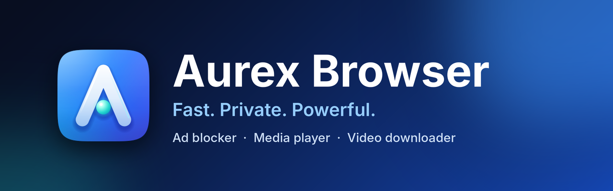

<div align="center">

<a href="https://github.com/aman-nitb-cse/Aurex-Browser/releases/latest"></a>


<a href="https://github.com/aman-nitb-cse/Aurex-Browser/stargazers"></a>
<a href="https://github.com/aman-nitb-cse/Aurex-Browser/releases"></a>
<br><br>
<a href="https://github.com/aman-nitb-cse/Aurex-Browser/releases/latest"></a>
<a href="https://t.me/aurex_oss"></a>
 
</div>
---
 
## 👋 About
 
**Aurex Browser** is a fast, privacy-focused Android browser written in Kotlin with Jetpack Compose. It combines an ad blocker, popup guard, built-in video player and universal downloader in one clean interface. No account, no server.
 
## ✨ Features
 
- 🛡️ **Ad, tracker and popup blocking**: EasyList, EasyPrivacy, uBlock Origin and AdGuard rules, cosmetic filtering, YouTube ad skipping, and a smart popup and redirect guard
- 🔒 **Privacy**: private tabs protected by your phone lock, adult-content filter, third-party cookie blocking, one-tap data clearing
- 🎬 **Built-in player**: gestures, Picture-in-Picture, background playback, and smooth 2K/4K YouTube
- ⬇️ **Downloader**: video and audio via yt-dlp and FFmpeg, quality choice, pause/resume/retry, plain file downloads
- 🎨 **Appearance**: dark mode for any website, glass-style UI, desktop site, data saver, long screenshots
- ⚙️ **Customisation**: configurable toolbar, menu and gestures, seven search engines, searchable settings
- 🔄 **Updates**: updates itself from [GitHub Releases](https://github.com/aman-nitb-cse/Aurex-Browser/releases), with SHA-256 check
## 📲 Install
 
1. Download the `.apk` from the [latest release](https://github.com/aman-nitb-cse/Aurex-Browser/releases/latest) (**Assets**)
2. Open it on your phone and allow installation if asked
3. Tap **Install**
Requires Android 7.0 (API 24) or newer.
 
## 🛠️ Build from source
 
Needs **JDK 17**, **Android SDK 35** and Android Studio (or Gradle 8.14+).
 
```bash
git clone https://github.com/aman-nitb-cse/Aurex-Browser.git
cd Aurex-Browser
./gradlew assembleDebug
```
 
The APK is in `app/build/outputs/apk/debug/`.
 
<details>
<summary>Release builds and publishing</summary>
**Signing.** Keys are never stored in the repo.
 
1. Create a key: `keytool -genkeypair -v -keystore aurex.keystore -alias aurex -keyalg RSA -keysize 2048 -validity 10000`
2. Create `keystore.properties` in the project root (git-ignored):
```properties
storeFile=aurex.keystore
storePassword=YOUR_PASSWORD
keyAlias=aurex
keyPassword=YOUR_PASSWORD
```
3. Run `./gradlew assembleRelease`
**Publishing.** Increase `versionCode` and `versionName` in `app/build.gradle.kts`, build the signed APK, then on GitHub go to **Releases → Draft a new release**, create tag `v` + `versionName` (e.g. `v1.0.1`), attach the `.apk` and publish.
 
</details>
<details>
<summary>🔐 Permissions</summary>
| Permission | Why |
|---|---|
| Internet, network state | Browsing, filter updates, downloads |
| Notifications | Download progress and media controls |
| Foreground service, wake lock | Background playback and downloads |
| Biometric | Phone-lock check for private tabs and adult filter |
| Install packages | In-app updates |
| Camera, microphone, location | Only when a website asks for them |
| Vibrate | Haptic feedback |
 
</details>
## 🧱 Tech stack
 
Kotlin · Jetpack Compose · Material 3 · Android WebView · AndroidX Media3 · OkHttp · yt-dlp + FFmpeg (youtubedl-android) · Coroutines · Gradle (Kotlin DSL)
 
## 🤝 Contributing
 
1. Fork the repo and create a branch
2. Make your change and check that `./gradlew assembleDebug` succeeds
3. Open a pull request
Found a bug? [Open an issue](https://github.com/aman-nitb-cse/Aurex-Browser/issues) (Settings → General → **Copy log** helps). Never commit keystores, passwords or `local.properties`.
 
## ⚖️ Responsible use
 
The downloader relies on yt-dlp. You are responsible for following copyright law and the terms of service of the sites you use it with.
 
## 🙏 Credits
 
Built on [yt-dlp](https://github.com/yt-dlp/yt-dlp), [youtubedl-android](https://github.com/JunkFood02/youtubedl-android), [FFmpeg](https://ffmpeg.org), [AndroidX Media3](https://github.com/androidx/media), [OkHttp](https://github.com/square/okhttp), [EasyList](https://easylist.to), [uBlock Origin filters](https://github.com/uBlockOrigin/uAssets), [AdGuard filters](https://github.com/AdguardTeam/AdguardFilters), [StevenBlack hosts](https://github.com/StevenBlack/hosts) and [Peter Lowe's list](https://pgl.yoyo.org/adservers/). Full list with licenses: **Settings → About → Open-source credits**.
 
## 📄 License
 
Free software under the **GNU GPL v3.0**. See [LICENSE](LICENSE).
 
---
 
<div align="center">
Made with ❤️ by **AMAN**
 
<a href="https://t.me/aurex_oss"></a>
<a href="https://github.com/aman-nitb-cse"></a>
 
⭐ If you like Aurex, please star the repo!
 
</div>
 
